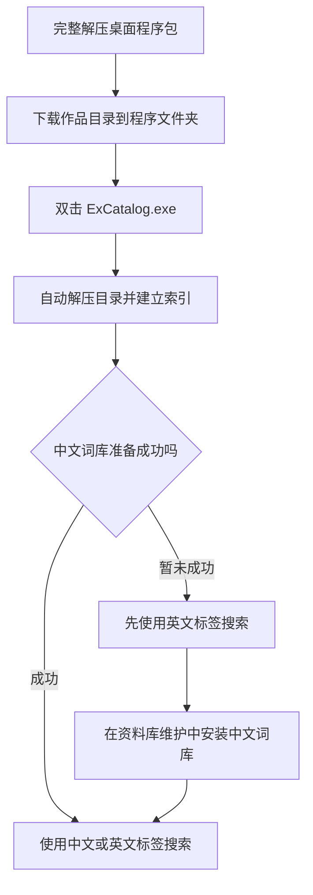
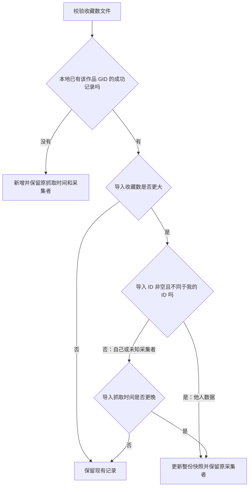
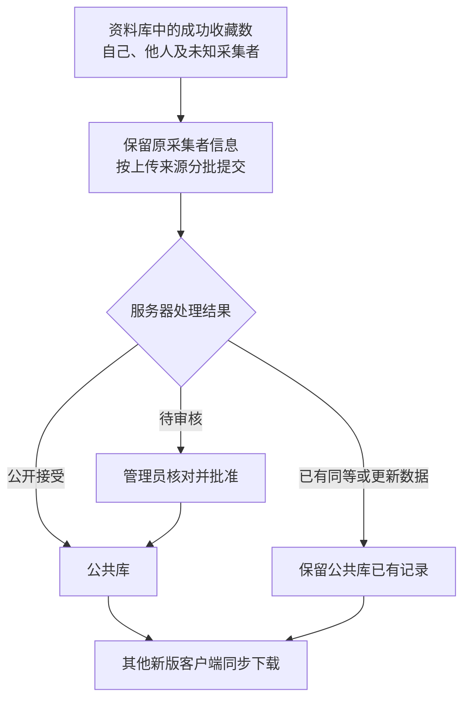

# EX资料库 · 本地标签搜索与收藏记录

一个在 Windows 本机运行的 E-Hentai / ExHentai 资料库工具。你可以组合中文或英文标签搜索作品、采集收藏数、管理阅读状态，并备份自己的记录。

**桌面版自带 Python 运行环境，无需安装 Python，也无需输入命令。** 完整解压程序包，放好作品目录数据，双击 `ExCatalog.exe` 即可。应用使用内嵌网页窗口，作品链接在默认浏览器中打开。

源码项目中使用 `启动桌面.cmd` 时，已具备 `desktop.py`、`client_version.py` 和 `.venv-desktop` 桌面环境的目录会优先启动当前源码，并继续使用原项目资料目录。新版在独立目录构建后，也不会因此自动启动 `dist` 中的旧 EXE。源码环境未齐备时可使用已有 EXE；完整发布包直接运行 `ExCatalog.exe`。切换前先关闭原窗口，版本可在客户端中核对。

当前客户端版本：**v1.1.36**。请求间隔提供 1、1.5、2、2.5、3 秒，记住上次应用的选择，重启或任务结束后不再重置为 4 秒；「标签搜索」与「已记录」的「显示方式」旁新增作品类型筛选，可与标签叠加。本次合并尚未单独发布的 v1.1.35 限流误判与冷却恢复修复，已有数据和队列保留，无需重新部署云端 Worker。完整历史可在「更新日志」查看。

获取程序：[本项目发布页](https://github.com/IGreyeyes/exhentai-local-catalog/releases)。桌面发布包文件名为 `ExCatalog-Windows-x64.zip`。GitHub 的 **Code → Download ZIP** 下载的是源码包，供开发和构建使用。

## 功能概览

| 功能 | 可以做什么 |
| --- | --- |
| 标签与标题搜索 | 组合中文 / 英文标签、标题关键词与作品类型，按发布时间、评分、页数、收藏数或收藏/评分排序；四种显示方式与记录页一致 |
| 收藏/评分评级 | 所有排序下均显示比值和评级，至少 20 人评分才评级；可独立排序并展开查看标准 |
| 排除与黑名单 | 排除本次不想看的标签，或保存为长期黑名单 |
| 收藏数采集 | 按分轮、分批或全量模式采集，暂停后可继续，未知与零收藏分别显示 |
| 我的记录 | 四种显示方式、彩色分类，筛选成功 / 失败、标签、作品类型、来源与时间 |
| 阅读状态 | 标记待看、在看、看过、不看，单独记录点开次数 |
| 收藏数导入导出 | 分享成功收藏数，预览后按规则合并，保留原抓取时间和原采集者 |
| 在线同步收藏数 | 上传资料库中全部成功收藏数记录，保留原采集者；上传者昵称可保存，上传与下载独立设置，新来源待审核 |
| GitHub 分享教程 | 导出后自动生成分享标题与正文，展开教程逐步学习压缩、发帖和上传附件 |
| 联系我们 | 左侧入口提供项目 GitHub 链接、QQ 群二维码和群号，二维码可查看完整尺寸 |
| 资料维护 | 备份和恢复个人资料，更新作品目录与中文词库 |
| 中文标签与封面 | 显示标签译名，缓存已经加载的封面 |
| 客户端更新 | 启动时自动检查一次新版，发现更新后由用户确认；支持系统代理、重试与续传、下载校验和安全安装 |
| 完整更新日志 | 左侧按版本浏览完整说明，标注当前版本、真实发布日期和合并公告；可离线查看并刷新 GitHub 历史 |

## 目录

- [使用前准备](#使用前准备)
- [首次使用](#首次使用)
- [日常打开与退出](#日常打开与退出)
- [程序升级与已有资料](#程序升级与已有资料)
- [搜索作品](#搜索作品)
- [采集收藏数](#采集收藏数)
- [查看记录与管理阅读状态](#查看记录与管理阅读状态)
- [封面显示与缓存](#封面显示与缓存)
- [备份与恢复](#备份与恢复)
- [仅导出与合并收藏数](#仅导出与合并收藏数)
- [在线同步收藏数](#在线同步收藏数)
- [更新作品目录](#更新作品目录)
- [更新中文词库](#更新中文词库)
- [文件保存在哪里](#文件保存在哪里)
- [常见问题](#常见问题)
- [联系我们](#联系我们)
- [数据时效与访问说明](#数据时效与访问说明)
- [数据来源与鸣谢](#数据来源与鸣谢)

## 使用前准备

| 项目 | 要求 / 说明 |
| --- | --- |
| 系统 | Windows 64 位；建议使用保持更新的 Windows 10 / Windows 11 |
| Python | 程序已内置，用户无需安装 |
| WebView2 | Windows 11 自带，Windows 10 多数已有；缺少时应用会提示并打开微软官方下载页，安装 **Evergreen Runtime** 后重新打开应用 |
| 程序包 | 完整的 `ExCatalog-Windows-x64.zip`，解压后保留 `ExCatalog.exe` 和 `_internal` 等随附文件 |
| 作品数据 | 自行下载 `e-hentai.db.zstd`，程序包不包含作品目录、个人记录或登录信息 |
| 磁盘 | 预留压缩包、解压后的数据库和索引空间；更新目录还需要新版暂存与旧版完整备份空间 |
| 网络 | 下载作品目录、更新中文词库、采集收藏数、读取未缓存封面和访问作品源站时需要网络 |
| 源站账号 | 本地标签和标题搜索不要求登录；收藏数采集需要能访问所选源站作品页 |

作品目录较大，请按实际文件大小预留空间。仅预留一份数据库的空间，可能不足以完成目录更新或完整备份。

WebView2 的官方下载入口：[Microsoft Edge WebView2](https://developer.microsoft.com/microsoft-edge/webview2/)。

## 首次使用

### 1. 完整解压程序包

将 `ExCatalog-Windows-x64.zip` 解压到一个固定、可写的文件夹，例如 `D:\ExCatalog`。在解压后的文件夹中运行应用，不要在压缩包内直接运行，也不要只复制其中的 exe。

后文的“程序文件夹”指直接包含 `ExCatalog.exe` 和 `_internal` 的文件夹。`_internal` 是程序运行所需的文件，请完整保留。建议使用自己的数据盘或用户文件夹，避免放在需要管理员权限才能写入的位置。

### 2. 下载作品目录

打开 [URenko/e-hentai-db 的 nightly 发布页](https://github.com/URenko/e-hentai-db/releases/tag/nightly)，下载 **`e-hentai.db.zstd`**，放到 `ExCatalog.exe` 同一文件夹。

保留准确的文件名和 `.zstd` 扩展名，无需手动解压。如果下载后带有 `(1)` 等后缀，请核对文件后改回 `e-hentai.db.zstd`。

首次启动前的目录示例：

```text
ExCatalog/
├─ ExCatalog.exe
├─ _internal/           # 随程序包提供，请完整保留
├─ README.md
├─ DESKTOP.md
├─ DEVELOPMENT.md       # 源码与构建说明，可选阅读
├─ THIRD_PARTY_NOTICES.md
└─ e-hentai.db.zstd      # 自行下载
```

### 3. 双击 ExCatalog.exe

应用会打开准备窗口，自动解压作品目录、建立查询索引并下载中文词库。首次准备可能需要几分钟，耗时取决于数据大小和电脑性能，请保持窗口打开。

准备完成后直接进入搜索界面。已有目录、收藏资料和词库会继续使用，日常启动不会重复覆盖。

中文词库下载失败时仍可使用英文标签搜索。之后进入 **资料库维护 → 中文词库 → 安装中文词库**补装即可。

### 4. 完成第一次搜索

输入 `language:chinese`，从建议中选择或按 Enter 添加，再点击 **搜索资料库**。安装中文词库后也可以输入“中文”，从建议中选择对应标签。

默认排除已移除、已隐藏及旧版本记录。收藏数初始显示“未知”，主动采集后才会有数值。



## 日常打开与退出

| 操作 | 方法 | 结果 |
| --- | --- | --- |
| 打开应用 | 双击 `ExCatalog.exe` | 使用已有资料进入搜索界面 |
| 查看已保存记录 | 点击侧栏 **已记录** | 查看收藏数、失败项与阅读状态 |
| 备份、恢复和更新 | 点击侧栏 **资料库维护** | 按页面提示完成相应操作 |
| 退出应用 | 关闭应用窗口 | 暂停采集，等待当前请求保存后退出 |

退出时可能需要等待当前采集请求结束，窗口标题会提示正在保存进度。备份、目录更新等维护任务或文件选择窗口打开时，应用会阻止退出，请完成或取消操作后再关闭。首次准备过程中也请保持窗口打开。

队列、轮次、收藏数和阅读状态会保留。下次打开后，采集不会自动开始，需要重新应用访问设置、验证并确认继续。

如果使用页面上的 **停止服务**，当前页面会停止查询，关闭窗口后重新打开应用即可继续使用。查看作品、GitHub 数据下载页等外部链接会打开默认浏览器；源站登录和验证仍在浏览器中完成。

## 程序升级与已有资料

### 在应用中更新（v1.1.0 起）

1. **每次启动客户端后会在后台自动检查一次正式发布版本**。发现新版时弹窗显示更新内容，可选择 **下载并更新**或 **稍后更新**；选择稍后后，本次启动不再自动提示。切换页面不会重新检查，下一次启动会再次检查。顶部 **检查客户端更新**按钮也可随时手动检查。
2. 有新版时查看更新说明，点击 **更新客户端 → 下载并更新**。程序显示下载进度，并校验 GitHub 提供的 SHA-256。v1.1.18 起，遇到连接中断、超时或临时服务错误时最多自动重试 3 次，本次下载尝试保留进度续传；服务器不支持续传时重新下载。
3. 校验通过后点击 **安装并重新打开**。程序暂停采集，等待当前请求保存后退出，再安装并重新打开。维护任务或文件选择窗口尚未结束时，请先完成或取消操作。
4. 更新保留原资料位置及 `data`、`logs`、`backups` 和作品目录压缩包；无需重新下载作品目录。若替换程序文件失败，会恢复旧程序。旧程序副本暂存在 Windows 临时目录的 `excatalog-update-*` 中。
5. 首次打开新版本时显示中文更新说明。弹窗按条目展示更新内容，支持标题、加粗与代码文字；较长内容可滚动阅读，操作按钮保留在底部。点击 **已读**后，同一版本在页面切换、关闭重开后均不再自动弹出；下一个版本再次显示。

客户端更新弹窗和安装后的公告仅展示目标版本或本次实际合并发布的版本，不附历史概览，也不自动罗列其他已发布的中间版本。已读状态继续保留；完整历史可随时在左侧「更新日志」查看。

左侧 **更新日志**提供版本列表与完整详情，可切换版本、选择显示预发布日志、手动刷新 GitHub 发布记录，并打开对应原文。正式发布日期按 UTC+8 显示；收录在合并公告中的版本标注来源，未虚构独立发布日期。内置历史日志随客户端提供，断网也能阅读；查看预发布日志不会启用预发布自动更新。

Release 正文也仅保留本次或合并版本及必要升级说明。旧客户端可读取同一份精简正文；历史详情在新版「更新日志」页面独立保存。

自动检查没有发现新版或遇到网络错误时不弹出提示，不影响日常使用。当前版本的未读更新说明关闭后，再显示发现新版的提示。检查失败、GitHub 暂时限流或发布包尚未上传时，可点击顶部按钮重试或使用下述手动方式。只有正式版本才参与更新检查；源码桌面运行可以检查版本，但请通过 GitHub Desktop 更新源码。

v1.1.18 起，客户端更新使用已配置的 HTTP/HTTPS 系统代理或环境代理，连接失败时交替尝试直连。需要代理时，请启用代理软件的 **系统代理**；收藏数采集表单的代理只用于采集，不控制客户端更新。持续失败时可点击弹窗中的 **打开发布页手动下载**。若旧客户端仍报 `[WinError 10054]`，请先按下述方法手动安装 v1.1.18，此修复安装后才生效。

### 手动更新桌面程序（包括 v1.0.0 首次升级）

1. 建议先在 **资料库维护**创建一份备份，等待当前维护任务结束后退出应用。
2. 将新版完整程序包解压到临时文件夹。
3. 把新版 `ExCatalog.exe`、完整 `_internal` 及说明文件复制到原程序文件夹，更新对应的程序文件。
4. **保留原来的 `data`、`logs`、`backups` 和作品目录压缩包**，再运行 `ExCatalog.exe`。

程序升级与作品目录更新是两个操作。升级程序不需要重新下载作品目录；更新作品目录按[更新作品目录](#更新作品目录)操作。目录更新或恢复任务尚未完成时，先处理完任务再移动程序文件夹。

### 从原浏览器版切换

1. 在旧网页点击 **停止服务 → 确认停止服务**；仅关闭浏览器标签页不会停止旧服务。
2. 将桌面发布包完整解压，把 `ExCatalog.exe`、完整 `_internal` 和说明文件放到原来的项目文件夹，与已有 `data` 同级。
3. 双击 `ExCatalog.exe`，继续使用原有资料，不需要转换数据库格式或重新安装 Python。

桌面版与浏览器版不能同时管理同一资料库。

## 搜索作品

### 基本操作

1. 在 **标签** 输入框输入中文或英文标签，选择建议；完整标签也可按 Enter 添加。
2. 添加多个标签时，作品必须**同时满足全部标签**，即 AND 关系。
3. 按需填写 **排除标签、标题关键词、作品分类、排序方式**。
4. 点击 **搜索资料库**。
5. 使用 **上一页 / 下一页** 或输入页码点击 **跳转**浏览结果。
6. 在 **打开作品时使用** 中选择 ExHentai 或 E-Hentai，再点击作品标题打开源站。

搜索至少需要一个包含标签或标题关键词；只选择分类、排序或排除条件不能发起搜索。标题关键词对原标题与日文标题作文字包含匹配，不会自动翻译标题。

### 标签输入规则

| 输入方式 | 示例 | 说明 |
| --- | --- | --- |
| 完整英文键 | `language:chinese` | 按数据库中的完整标签精确匹配 |
| 中文译名 | `中文`、`汉语` | 词库可用时解析为对应标签；有歧义时需从建议选择 |
| 命名空间缩写 | `l:chinese`、`lang:chinese` | 自动展开为 `language:chinese` |
| 末尾精确标记 | `language:chinese$` | 接受末尾 `$`，内部按完整标签匹配 |

常用缩写：`l` / `lang` → `language`，`a` → `artist`，`g` → `group`，`c` → `character`，`p` → `parody`，`o` → `other`，`f` → `female`，`m` → `male`，`x` → `mixed`。

输入片段可以获得建议，但正式搜索使用完整标签。已选标签显示中文译名与原始英文键；结果标签显示中文，悬停可查看英文。未翻译的标签保留原文。

一次最多包含 **12 个标签**、明确排除 **200 个标签**；每个输入项与标题关键词最多 **200 个字符**。

### 排除标签与持久黑名单

- **排除标签**只用于本次搜索，命中任意一个排除标签的作品都会被排除。
- 点击 **将当前排除标签加入黑名单**，可以长期保存这些排除项。
- 持久黑名单默认用于后续搜索；取消 **本次搜索应用持久黑名单** 可以临时关闭。
- 点击黑名单标签的移除按钮可以删除该项。清空普通搜索条件不会删除已保存的黑名单。
- 同一个标签不能同时被包含和排除；如果它在黑名单内，先移除或临时关闭黑名单。
- 黑名单保存在 `data/favorites.sqlite3`，重启后保留，也会随收藏资料备份。

例如，包含 `language:chinese` 和 `other:anthology`，会搜索同时属于中文与合集的作品；排除条件与黑名单会在这个范围上继续过滤。

### 排序与历史记录

搜索支持发布时间从新到旧 / 从旧到新、平均评分从高到低、作品页数从多到少、已采集收藏数从高到低，以及**收藏/评分从高到低**排序。排序针对**全部匹配记录**执行，然后分页；选择收藏数排序时，未知值的作品始终排在已知值之后。

**收藏/评分 = 已保存收藏数 ÷ 已保存评分人数**，采用 [Mayriad 脚本的替代评分标准](https://github.com/Mayriad/Mayriads-EH-Master-Script/wiki/Feature-descriptions#alternative-rating-system)。至少 **20 人评分**才参与评级，显示比值**向下保留一位小数**，没有 5 分上限。例如 210 次收藏 ÷ 77 人评分 = 2.727…，显示为 **2.7（一般）**。

| 收藏/评分比值 | 评级 |
| --- | --- |
| 10 及以上 | 杰作 |
| 7 至不足 10 | 优秀 |
| 4 至不足 7 | 良好 |
| 1 至不足 4 | 一般 |
| 0 至不足 1 | 冷门 |

搜索页与「已记录」页的**所有排序方式、四种显示方式均显示收藏/评分及评级**；排序区域的 **收藏/评分怎么算？查看评级标准** 可展开查看公式、阈值、示例和数据补齐方法。悬停卡片指标可查看计算过程与评分人数采集时间。缺少收藏数或评分人数显示「未知」，评分人数为 0 显示「未评分」，1 至 19 人评分显示「样本不足」及人数 / 20。

选择 **收藏/评分 · 从高到低** 时，按**未截断比值**排序，比值相同时按作品 ID 从大到小排列；未知、未评分和样本不足的作品排在最后。零收藏且评分人数达标时，显示有效的 **0.0（冷门）**。搜索结果在所有排序下提示可评级的覆盖数量；覆盖不足时仅代表数据达标的部分。

该指标反映收藏与评分的相对关系，作为挑选作品的辅助参考。数值来自本地快照，分子与分母可能来自不同时间；评分样本较少也可能抬高比值，不能直接代表客观质量或源站实时排名。

基础作品目录不包含评分人数。**v1.1.8 起，采集收藏数时会从同一张作品页一并保存评分人数，不增加额外请求。** 旧记录需后续刷新采集补齐：关闭「只抓取从未成功采集过的作品」，选择合适的缓存周期，让需要补齐的旧记录进入待采集范围；仍在缓存期内的作品会跳过，评分人数为 0 的作品需等源站有人评分后再刷新。升级和选择排序不会自动发起采集；源站字段缺失或格式异常时保留已有评分人数，未采集到的值仍为未知。资料库备份包含评分人数；收藏数分享文件仍只包含收藏数及原抓取时间、原采集者，导入分享文件不会补齐评分人数，比值使用本地已有数据计算。

默认排除数据库标记为 `removed`、`expunged`、`replaced` 的记录。勾选 **包含已移除、已隐藏及旧版本记录**，可以将这些历史记录纳入搜索。

收藏数最初显示 **未知**，需要主动采集后才有数值；零收藏是成功读取的有效数值，与未知不同。搜索结果会显示收藏数覆盖数量与近 7 天更新数量，便于判断收藏排序的覆盖程度。

搜索结果上方的 **显示方式** 与「已记录」一致：最小化（密集列表）、紧凑 + 标签（无封面的标签列表）、扩展（封面和完整分组标签）、缩略图（封面网格），首次使用默认扩展。扩展视图按画师、原作、角色、语言等命名空间完整展示标签，匹配标签高亮，点击标签可添加到搜索条件。卡片使用彩色分类，展示醒目的收藏数及原采集者；未知收藏数显示「—」，零收藏显示「0」。

搜索页和记录页 **分别保存** 显示方式到本地资料库，重启、升级和备份恢复后继续使用；切换视图保留当前搜索条件、排序和页码。仍可选择打开作品使用 ExHentai 或 E-Hentai。阅读标记和点开记录在「已记录」页面管理。

在搜索结果的「显示方式」旁选择 **作品类型**，可在已应用的标签、标题、黑名单等条件内继续筛选。类型与上方「作品分类」同步，选择后自动回到第 1 页；选择「全部类型」取消限制。筛选针对全部匹配作品，再按原排序分页；切换显示方式、翻页、刷新及浏览器前进后退均保留类型条件。

## 采集收藏数

采集会请求所选源站的作品详情页，读取收藏人数与评分人数，写入独立的 `data/favorites.sqlite3`。**候选来自本次搜索的全部匹配作品，不受当前页限制。** 本地搜索与采集是两个操作，点击搜索不会自动采集收藏数。

### 1. 配置源站与登录信息

先完成一次搜索，展开搜索框下方的 **收藏数采集**，建议第一次用匹配数量较少的条件验证访问。

1. 在 **采集源站** 选择自己能够访问的站点。
2. ExHentai 需要填写 `ipb_member_id`、`ipb_pass_hash`、`igneous` 三项 Cookie 的 **Value**。E-Hentai 可以先不填写 Cookie 尝试公开访问。
3. 在 Chrome / Edge 打开正常可访问的源站作品页，按 **F12 → 应用（Application）→ 存储 → Cookies**，选择对应域名并找到三项值。
4. 将值填入本地表单，按需设置代理、间隔、缓存周期与采集模式，再点击 **应用本次设置**。

只填写每项的 Value，不要复制完整请求头，也不要把 Cookie 发到聊天、Issue 或提交到 GitHub。

| 设置 | 默认值 | 可选范围 / 行为 |
| --- | --- | --- |
| 采集源站 | ExHentai | ExHentai / E-Hentai；继续已有任务时必须与原任务一致 |
| 请求间隔 | 上次应用的值；首次 3 秒 | 可选 1、1.5、2、2.5、3 秒，点击「应用本次设置」后保存；通常在上次请求结束后等待设定间隔 |
| 缓存刷新周期 | 7 天 | 1 / 7 / 30 天，或自定义 1～3650 天 |
| 采集模式 | 分轮抓取 | 分轮 / 分批 / 全量，详见下表 |
| 每轮 / 每批数量 | 1,000 条 | 100 / 300 / 1,000 / 3,000 / 5,000，或自定义 1～100,000 条 |
| 按平均评分优先 | 关闭 | 控制新队列的候选顺序，与搜索结果排序分别设置 |
| 跳过已有收藏数 | 关闭 | 开启后仅补充从未成功取得收藏数的作品，不看缓存年龄 |
| HTTP 代理 | 留空 | 网络已可访问时可留空；需代理时填写 HTTP / HTTPS 地址，例如 `http://127.0.0.1:7890`，端口以实际配置为准 |

代理字段不支持 `socks5://`、用户名密码、查询参数或额外路径。收藏数采集表单的代理只用于收藏数请求，不控制封面下载或词库更新。

### 2. 选择采集模式

| 模式 | 建立任务时保存什么 | 完成后如何继续 | 适用场景 |
| --- | --- | --- | --- |
| **分轮抓取** | 按跳过规则筛选后，保存全部待抓取队列、顺序和轮次；首次只执行第 1 轮 | 每轮结束自动停止，手动预估并确认下一轮 | 逐步覆盖一个较大的固定范围，跨多次启动续抓 |
| **分批补充** | 保存本次挑选的一批候选与原始搜索范围 | 完成本批后，按原始范围重新预估并追加下一批 | 按次补充记录，逐步抽样或刷新 |
| **全量采集** | 保存整个范围的待处理任务 | 运行到完成或手动暂停，不按轮自动停止 | 希望连续处理全部待抓取作品 |

分轮与分批的数量表示作品条数，不包含独立的单条验证；失败重试可能产生额外请求。

例如，按跳过规则计算后有 10,000 条待抓取作品，每轮 1,000 条，则建立 10 轮。最后一轮不足设定数量时，只处理剩余作品。这个例子仅用于说明轮次计算，不是数据库固定规模。

### 3. 验证、预估并确认

1. **应用本次设置**：让本地服务接收表单设置。
2. **随机验证源站访问**：从本次搜索或原任务范围中随机取样，优先选择符合跳过规则的缓存、已完成记录；没有这类样本时随机选择待处理作品。原任务的缓存补充样本仍匹配原搜索条件，分轮验证只在当前允许验证的轮次及已有记录中取样，不扩展到更后续轮次，评分优先和队列顺序只影响正式采集。缓存及已完成样本实际请求源站，但不改写已有收藏数、评分人数、来源、原采集者或采集时间，也不改变队列状态；待采集样本读取成功后仍保存结果。当前范围没有需要处理的作品时不请求源站。正常作品页的脚本、注释或评论中的不可用字样不会覆盖可靠的收藏数字段；评论或介绍中的限流、封禁及浏览器验证文字也不会触发冷却。真实 HTTP 429 和浏览器验证标记仍会暂停。验证每次最多尝试 3 条，遵守请求间隔；不可用样本继续记录或暂缓，再次验证随机换其他候选，处理访问问题后可点击 **重新验证失败作品**。已缓存样本的确认操作只保存失败记录，不改变原队列或删除成功数据；待处理作品确认后可提前从队列跳过。登录、权限、浏览器验证及限流仍会停止请求。随机取样无法保证当前不可访问的作品恢复可用。
3. **预估采集耗时**：只读取本地数据，核对全范围数量、待抓取数量、缓存跳过数、轮数 / 批量与留待后续的数量。
4. 确认范围无误后点击 **确认开始采集**。分轮模式的预估耗时与首次执行范围都是第 1 轮。
5. 查看顶部进度卡；需要最新排名时点击 **刷新搜索结果**，或进入 **已记录**。

可在验证前先预估，但实际启动仍须先完成访问验证。预估本身不建立任务、不访问源站；只有单条验证和确认后的采集才请求作品详情页。

**浏览器能打开同一链接，客户端却提示不可用时**：从浏览器中当前源站重新复制三项 Cookie 的 Value，只填到本地表单；确认客户端 HTTP 代理与浏览器使用相同的网络出口，再点击 **应用本次设置 → 验证原任务的源站访问**。浏览器扩展的代理设置不一定适用于客户端。手动验证时，若浏览器也打不开，可点击 **确认不可访问并跳过** 提前处理；正式批量采集会自动将不可用作品记为失败并继续，不必逐条确认。验证成功后重新预估并继续原任务，失败项可在采集结束后单独重试；无需结束任务或重新下载作品目录。

预估按 `待抓取数量 ×（请求间隔 + 单条读取耗时）` 计算。读取耗时优先使用最近最多 20 次成功请求的平均值；没有实测值时按每条 2 秒估算，并在界面注明。估算不包含失败重试、源站限流与人为暂停；全部跳过时预计耗时为零。

预估有效期为 **10 分钟**。修改设置、搜索范围、缓存或队列后，需要重新预估，旧确认不能启动其他范围的任务。

请求间隔仅提供 **1、1.5、2、2.5、3 秒**。选择后点击「应用本次设置」，下次打开、重启客户端、一轮结束或暂停后继续沿用上次应用的值，不再回到 4 秒。旧版没有独立设置时会尝试恢复最近任务中的有效间隔；首次使用或旧值不在新选项中时使用 3 秒。间隔也会随资料库备份保存；登录 Cookie 仍只保存在内存中。请求频率仍需遵守源站规定，限流与冷却保护继续生效。

### 4. 候选选择与缓存规则

**评分优先关闭时：** 分轮 / 分批先应用缓存规则，优先从未成功记录的作品，再优先此前没有尝试过的候选；按发布时间分年份轮流分配名额，各年份内部按平均评分降序、作品 ID 降序选择。年份不足时由其他年份补足，未知发布时间单列一组。全量模式默认按作品 ID 从新到旧执行。

**评分优先开启时：** 分轮 / 分批不再均衡年份，而是先处理此前未尝试的候选，再按平均评分降序、作品 ID 降序排列；全量模式也使用这个评分优先顺序。评分来自基础目录快照，不是收藏数，也不是评分人数。

**缓存规则：**

- 未开启“跳过已有收藏数”时，成功采集且未超过缓存天数的记录会复用；未知或过期记录需要抓取。
- 开启 **只抓取从未成功采集过的作品，跳过已有收藏数** 后，所有成功记录都跳过，不受缓存年龄影响；成功读取的零收藏也会跳过。
- 从未成功的失败项仍可补抓。默认分批选择会优先新候选，避免失败项反复占满下一批。
- 超过缓存周期不会自动发起刷新，只在再次主动建立 / 继续任务并应用跳过规则时决定是否请求。
- “未纳入本轮 / 本批”与“缓存已跳过”分别统计，未采集作品不会被标成已完成。

按评分挑选的一批作品不一定是收藏数最高的作品。覆盖不足时，收藏排名只能代表已经采集的部分。

### 5. 暂停、续抓与关闭后恢复

**正式批量采集无需逐条确认不可用作品**：全量、分批和分轮模式遇到 `Gallery Not Available`、无收藏数字段的不可用提示，或无法确认原因的 HTTP 404 / 410，会记录该条失败并继续后续队列，仍遵守请求间隔。失败不表示已确认作品删除，不覆盖已有收藏数或评分人数；采集结束后可在「已记录」查看原因与链接，统一预估重试。明确的登录提示、权限拒绝、浏览器验证、限流及无法识别的页面仍会暂停；临时网络错误继续按原规则重试。分轮采集仍在本轮结束后按原策略停止，不自动开启下一轮。

| 操作 | 行为 |
| --- | --- |
| 暂停本轮 / 暂停任务 | 等待当前已发出的请求结束，保留已获得的收藏数与剩余队列 |
| 继续本轮 | 预估并确认后，处理已开启轮次中仍待处理的项目 |
| 继续第 N 轮 | 分轮模式在上一轮结束后手动开启下一轮，不会自动连跑 |
| 重试失败项 | 先预估再确认，处理原任务已开启轮次内的失败项；不会开启后续轮次 |
| 预估并追加下一批 | 分批任务完成后，按原始搜索范围重新挑选下一批 |
| 结束任务 | 结束当前整个计划，保留已采集结果；需要新范围时再建立新任务 |

队列、轮次与进度保存在本地资料库中。**关闭桌面应用会暂停采集并等待当前请求保存**；重新打开后，任务不会自行请求源站。分轮运行至当前轮结束会自动停止，下一轮需要手动确认。

重启后恢复已有计划：

1. 双击 **ExCatalog.exe**，首页会显示已保存的进度卡，不必重新搜索原来的标签。
2. 重新填写访问设置，或导入加密登录文件，并确保源站与原任务一致。
3. 点击 **应用本次设置**，再点击 **验证原任务的源站访问**。
4. 轮中暂停时选择 **继续本轮**；一轮已完成时选择 **继续第 N 轮**，预估后确认。

分轮计划建立后，后续队列、每轮数量与顺序固定；更改搜索条件、每轮数量、评分优先开关或基础目录不会替换这个计划。继续时会按当前跳过规则复用已经取得的收藏数。未完成计划需要先继续或结束，才能建立新任务。

“已处理”与进度条包含失败和跳过项目，不表示每条都成功。可先重试已经开启轮次的失败项，也可继续后续轮次。分轮计划只有整个计划完成时，才触发“任务完成后自动备份”。

### 6. 登录信息与加密文件

- Cookie 默认只保存在本次运行的**内存**中，不写入数据库、日志或窗口本地存储。刷新页面不清除设置，退出应用后需重新配置。
- 同一源站已有设置时，三项 Cookie 输入框全部留空可以沿用本次内存中的值；更换源站或重新填写时需提供相应信息。
- 应用设置后可点击 **导出加密登录文件**，保存 `.ehcred`；下次点击 **导入加密登录文件**即可重新加载访问设置。
- 文件使用 Windows DPAPI 加密，面向同一台电脑上的当前 Windows 用户；换电脑或换 Windows 用户后不能作为通用登录备份使用。
- 登录文件保存源站、代理与 Cookie，不保存全部采集参数。导入后仍需核对模式、间隔等设置，并执行一次访问验证。
- 程序资料库备份不包含 `.ehcred`，请单独妥善保管。
- 只更改缓存天数、跳过选项或请求间隔，源站 / 代理 / Cookie 未变时，可以沿用本次已验证状态；重启服务后仍需重新验证。
- 验证期间不可访问作品的跳过记录仅在内存中保存。只调整采集参数不会清除；更换源站 / Cookie / 代理、点击 **重新验证失败作品** 或退出程序后会清除。该记录只影响访问验证，不阻止正式采集或单独重试失败项；验证原任务仍限定于原任务当前可处理的轮次，不自动开启后续轮次。

### 7. 失败与限流处理

v1.1.28 起，网页接收中断、响应格式异常及已声明长度却未完整传输的网页也按临时网络错误处理。即使残缺网页已有收藏数字段，也不会保存或覆盖上次结果；超出可保存范围的收藏数会明确暂停。

其他异常暂停会显示安全的错误类型与阶段。资料库占用时等待当前资料库操作结束；磁盘空间不足或无法写入时先处理空间与权限，再预估并继续原任务。诊断日志仅记录固定错误标签、阶段和程序行号，不写入异常原文、登录信息、代理地址、网页内容、作品信息或个人路径。无法写入暂停状态时保留原队列，排除磁盘或权限问题后重启，重新应用设置并验证原任务后继续。

读取失败不会将上次成功的收藏数清零。临时网络错误会等待后重试，最多尝试 3 次；作品不可访问等终止错误会记录为失败项。

登录失效、浏览器验证页、未知页面格式或限流会暂停整个任务。限制提示页面采用一小时保护冷却，HTTP 429 按响应中的等待时间（缺失时默认 15 分钟）冷却；状态保存在数据库，重启不会清除。

若浏览器已能打开同一作品链接，请核对客户端 Cookie 和 HTTP 代理是否与浏览器访问一致，应用设置后点击 **浏览器已恢复，单次验证**。冷却期间每分钟最多手动请求 1 条，也遵守原请求间隔；不会连续换 3 条。只有客户端实际成功读取才解除所有保存的冷却，原任务仍保持暂停，需重新预估并确认继续。失败、无待处理作品或未请求源站时保留冷却；恢复验证间隔也会保存，重启不会绕过。需要浏览器验证时，在源站浏览器中处理，再回到本地页面手动验证。

进度卡默认折叠失败详情，展开可查看最近 5 条失败原因与访问链接；点击 **在已记录中查看全部失败作品**，可以查看原任务的全部未解决失败作品。

## 查看记录与管理阅读状态

「已记录」结果的「显示方式」旁也提供 **作品类型**，与已应用的标签、来源、时间、阅读状态及成功 / 失败条件叠加。更改类型会回到第 1 页并清空批量选择；「全部类型」取消类型限制，「清空筛选」同时重置类型。缺少目录信息、无法判断类型的记录仍可在「全部类型」查看。

点击侧栏 **已记录**。该页面使用本地数据，点击 **刷新记录** 不会重新采集源站收藏数，也不要求提供 Cookie。

### 查看成功与失败记录

- 默认展示全部成功与失败作品，每个作品只显示一张卡片；可切换 **全部记录 / 采集成功 / 抓取失败**。
- 默认按收藏数从高到低排序，未知值置后；切换失败列表时默认按失败记录时间从新到旧排序。
- 支持标题 / 作品 ID、中文或英文标签、采集来源、记录时间、阅读状态与是否点开组合筛选。多个标签必须同时满足。
- 记录时间可选择全部、最近 7 / 30 / 90 天、30 天以前；成功记录使用成功采集时间，失败列表使用失败记录时间。
- 可按收藏数升 / 降序、收藏/评分降序、采集时间新 / 旧、平均评分或标记时间排序，支持分页与页码跳转。所有排序均显示收藏/评分及评级；计算标准、样本要求与补齐规则见[排序与历史记录](#排序与历史记录)。
- **显示方式**可选：最小化（密集列表）、紧凑 + 标签（无封面的标签列表）、扩展（封面和完整分组标签）、缩略图（封面网格）。显示方式保存到本地个人资料库，退出、重启和程序升级后会继续使用上次选择；也随资料库备份保存。首次使用默认是扩展；选择缩略图后，下次打开记录页仍是缩略图。切换方式保留筛选、排序、分页和已选记录。旧版本保存的「最小化 + 关注标签」在升级后自动改为「最小化」。
- 同人志、图片集、漫画、画师 CG 等分类显示中文彩色色块，便于快速区分。
- 卡片展示收藏数、采集时间、源站、原采集者昵称与 ID 前缀、原标题和标签；自己的记录显示「我」，旧数据显示「未知」。扩展视图中的标签完整显示，并按画师、原作、角色、语言等命名空间分组。点击标签可在已记录范围内筛选。
- 零收藏、旧版本、已移除记录均保留。基础目录更新后找不到元数据时，仍显示作品 ID、收藏数或失败信息、时间；失败项可使用队列保存的原始访问链接。

曾成功采集但最新刷新失败的作品显示 **刷新失败**，保留上次成功数值和时间；从未成功的作品显示 **尚未取得收藏数**。重试期间失败记录仍保留，成功后自动移出失败列表。旧队列的未解决失败项会自动导入；旧版没有逐条失败时间时，使用对应任务的更新时间。

每个作品当前保留一份成功收藏数结果与当前未解决失败信息。成功结果来自自行采集或按规则接受的导入快照；他人收藏数更大时，即使抓取时间更旧，也可能被接受。没有保存每次收藏数变化的历史曲线。

### 点开次数与阅读状态

**点开记录**与**阅读状态**分别保存：

| 状态 / 指标 | 含义 |
| --- | --- |
| 未分类 | 尚未手动分类 |
| 待看 | 准备之后查看 |
| 在看 | 正在查看 |
| 看过 | 已查看，由用户手动标记 |
| 不看 | 暂不考虑查看 |
| 点开次数 / 最近点开时间 | 从“已记录”页面点击作品标题或“查看源站”的本地记录 |

单张卡片可以修改阅读状态，也可勾选多条 / 选择当前页，再点击 **应用到已选记录**批量设置；一次最多更新 1,000 条。顶部状态统计可以快捷筛选。

点击作品不会自动变为“看过”。从其他页面、浏览器标签页或设备打开作品，程序无法感知，因此“已点开”只代表从已记录页面发起过打开操作，不证明源站加载成功或已经阅读。

这些标记保存在 `data/favorites.sqlite3`，重新采集、更新基础目录和普通备份都会保留；失败作品也能标记，之后采集成功仍保留。**恢复未分类**只清除手动分类，不清除点开次数与时间。导入旧备份则会将这些资料恢复为备份中的状态。

## 封面显示与缓存

封面在接近可见区域时加载，成功后保存在本机，下次显示相同封面时复用缓存。应用不会预先下载整个作品目录的封面。

- 在 **资料库维护 → 封面缓存**查看数量、大小、失败数与保存位置。
- 封面读取不携带源站登录 Cookie，也不使用收藏数采集表单中的代理设置。
- 封面读取失败时显示占位图，同一失败地址 24 小时内不重复请求。
- 离线时可以搜索本地资料和查看已缓存封面，未缓存封面需要网络。
- 封面缓存可重新生成，不包含在个人资料备份中。

## 备份与恢复

点击侧栏 **资料库维护**。

### 选择备份位置

默认位置为程序文件夹中的 `backups/`。点击 **选择文件夹**，或输入另一个磁盘、移动硬盘、已连接网络共享文件夹的完整路径，再点击 **保存位置**。不存在的文件夹会自动创建，**恢复默认**可切回程序文件夹中的 `backups/`。

选择独立的备份文件夹，不要使用程序文件夹本身、`data/` 或 `_internal/`。手动备份、自动备份、目录更新与备份导入前的保护备份都使用当前保存的位置。切换位置不会移动或删除原位置的备份。

### 手动与自动备份

| 备份类型 | 内容 | 建议用途 |
| --- | --- | --- |
| **轻量备份** | 采集身份、收藏数及原采集者、失败记录、阅读状态、黑名单、采集队列与进度、中文词库、相关元信息、程序文件（含 exe 和 `_internal`） | 日常保留个人资料，体积较小 |
| **完整备份** | 轻量备份内容，加上完整 `catalog.sqlite3` 作品目录 | 目录更新前保护、迁移或从零恢复 |
| **仅导出收藏数** | 作品 ID、收藏数、原抓取时间、源站、原采集者 ID 与昵称，保存为独立 JSON 文件 | 迁移或分享成功收藏数，导入时按规则合并，详见下节 |

在维护页点击 **立即备份**创建轻量备份；勾选 **同时备份作品目录**后创建完整备份。可以在应用运行时备份，无需先退出。请优先使用这个功能，确保正在运行的资料库也能得到完整一致的副本。

默认备份**不包含整个基础作品数据库**，但会保存完整的个人收藏资料库（包括采集任务、阅读状态等）；「完整备份」才额外包含基础作品目录。「仅导出收藏数」是独立的数据迁移功能，导入时合并记录，不用它替换整套资料。

开启 **采集任务完成后，自动备份到上述位置**，会在任务完成时创建轻量备份，含存在失败项的完成状态。该功能默认关闭，按任务完成触发，不是后台定时备份；分轮尚有下一轮时不触发。

每份备份有独立文件夹和 `manifest.json`，记录文件大小及 SHA-256。文件夹名称中的 `Z` 表示 UTC 时间。维护页只显示当前位置最近 10 份，**不会自动删除更早备份**。失败或中断的备份保留为 `.partial` 文件夹，不列为成功备份。

Windows 若暂时拒绝将备份文件夹从 `.partial` 改名为正式备份，程序会显示等待进度，最多自动重试 5 次。持续失败时检查备份位置的写入、修改权限，关闭可能占用备份的程序后重试。收藏数合并、备份导入和选择「备份旧版并应用更新」的目录更新，会等待保护备份成功后才继续；未完成的 `.partial` 备份不能用于恢复，不要直接将其改名为成功备份。

「备份我的资料」和「更新作品目录」都会显示实际备份目录、该位置的成功备份总数，以及完整 / 轻量备份数量。总数包含列表之外的早期备份，未完成的 `.partial` 备份不计入。目录更新使用已经保存的备份位置；要更换磁盘，先在备份区域选择文件夹并保存位置。

两种备份都不包含 Cookie、`.ehcred`、日志、原始 `.zstd` 压缩包或封面缓存。

### 导入已有备份

1. 在最近备份中点击 **导入这份**，或选择 / 粘贴具体备份文件夹的完整路径。
2. 该文件夹应直接包含 `manifest.json`，不要选择存放多份备份的父目录。
3. 需要恢复完整目录时，勾选 **同时恢复作品目录**；这要求所选备份是完整备份。
4. 点击 **检查备份**。程序校验清单中所有文件的大小与 SHA-256，并暂存待恢复资料。
5. 核对收藏数记录、阅读状态标记和采集计划数量，勾选确认。
6. 点击 **备份当前资料并导入**。程序暂停采集、等待当前请求完成，自动保护备份当前对应资料，然后导入。
7. 完成后刷新页面。导入后的采集计划保持暂停，核对登录设置并验证后再继续。

**导入会替换对应个人资料**，包括采集身份、收藏数及原采集者、失败记录、阅读状态、黑名单与采集进度，并恢复备份内的中文词库。轻量备份保留当前作品目录；完整备份可同时恢复目录。恢复没有采集身份的旧备份时，程序会生成新的 ID；若要沿用原身份，可再通过下述身份迁移功能导入自己的身份文件。

导入备份只恢复资料，不执行或覆盖备份里的程序文件；当前备份位置、自动备份选项与本次运行中的登录设置保留。失败会回退原资料；切换时意外退出，下次启动会检查恢复记录。

### 换电脑或原程序文件夹丢失

- **有完整备份：** 在新电脑下载并完整解压桌面程序包。确认应用未运行，把完整备份中的 `data` 复制到新程序文件夹，再打开 `ExCatalog.exe`。也可以使用备份中已有的 exe 和 `_internal`，保持与 `data` 同级。
- **只有轻量备份：** 先按首次使用步骤准备作品目录，打开应用后在维护页导入轻量备份。
- **从原浏览器版备份恢复：** 使用新的桌面程序包恢复资料，无需安装 Python；完整备份中的 `data` 同样可用。
- 迁移后在维护页核对备份保存位置，原电脑的绝对路径不会自动改成新电脑的位置。
- 新电脑需要重新配置源站登录信息，原电脑导出的 `.ehcred` 只能由原电脑的原 Windows 用户解密。
- 目标文件夹已有个人资料时，先单独备份，避免直接覆盖已有 `data`。

## 仅导出与合并收藏数

进入 **资料库维护 → 收藏数导入导出**。收藏数按源站作品的 **GID（作品 ID）**匹配；同一个作品在 E-Hentai / ExHentai 使用同一 GID，标题或标签变化不会影响匹配。不同版本如果有不同 GID，会保留为不同作品。

### 我的采集身份与换电脑迁移

- **采集者 ID**：首次使用时自动生成，保存在 `data/favorites.sqlite3` 中，重启、改昵称和更新作品目录都不会重新生成。ID 代表一个采集身份，不是源站账号，也不用于验证真实个人。
- **生成昵称**：采集者 ID 在首次启动服务时已自动生成；在「我的采集身份」中填写昵称，点击 **生成昵称** 保存。留空时显示为匿名采集者，提交只保存昵称并沿用已有 ID。昵称保存后显示独立的修改按钮。
- **修改昵称**：昵称保存后，点击独立的 **修改昵称** 按钮进入编辑，点击 **保存修改** 保存，或点击 **取消** 放弃编辑。昵称选填，最多 40 个字符；保存后当前 ID 所属的已存记录也会更新昵称，ID 保持不变。昵称可以重名，判断自己的数据使用完整 ID。
- **停止与重启**：ID、昵称和生成状态均保存在本地收藏资料库中，正常停止服务、重新启动、刷新页面都不会改变。删除资料库、恢复其他备份或主动迁移身份时，才可能改变当前身份。
- **自行采集**：成功取得收藏数时，自动保存当前自己的 ID 和昵称；自行刷新他人的记录成功后，这份新结果属于当前采集身份。
- **转存分享**：导入别人的收藏数不会切换自己的身份；每条接受的记录保留原采集者。之后再导出，仍携带原采集者 ID 和昵称，不把文件导出者误当作抓取者。「已记录」卡片会显示采集者昵称、ID 前缀和自己的标识，悬停可查看完整 ID。
- **旧数据**：升级前的记录和旧版收藏数文件无法可靠判断是谁采集的，统一标为「采集者未知」，不自动归到当前自己的名下。

换电脑时展开 **换电脑：导出或迁移我的采集身份**：

1. 在原电脑点击 **导出我的采集身份**，选择保存位置，保存 `collector-identity.ehcollector.json`。
2. 在新电脑选择该文件，点击 **检查采集身份**，核对 ID 和昵称。
3. 勾选确认，点击 **备份并迁移我的身份**。程序暂停采集、等待请求结束，自动轻量备份，再切换身份；之后自行采集沿用原 ID。

身份迁移不会重写已有记录的原采集者 ID；同一个 ID 的昵称随迁入的身份更新。切换后已检查的收藏数合并预览会失效，需要重新检查。身份文件仅用于在自己的设备间迁移身份；向其他用户分享数据用 **仅导出收藏数** 生成的文件。两类导出都不含 Cookie。

如果界面提示需要重新启动，请退出应用并重新打开 `ExCatalog.exe`，以加载新版功能；已保存的采集身份会保留。

### 仅导出收藏数

点击 **仅导出收藏数**，在保存窗口选择位置，保存 `.ehfavorites.json` 文件。取消保存不会写出文件。导出覆盖本地全部成功采集过的作品，含成功取得的零收藏；作品最近刷新失败但曾成功取得数值时，也会导出保留的成功快照。从未成功取得收藏数的失败项不会导出。

文件保留作品 ID、收藏数、原抓取时间、源站和原采集者信息。文件的导出时间仅说明文件何时生成，**不会代替每条作品的原抓取时间**。无需手动修改文件内容，使用应用中的导入功能即可。

导出成功后，下方的 **如何在 GitHub 讨论区分享收藏数（点击展开）** 会自动展开，并按**本次实际导出的文件**生成记录数量、原抓取时间范围、导出时的客户端版本、分享日期，以及可直接复制的标题和正文。时间范围覆盖文件内全部成功记录（包括已合并的他人记录），按北京时间 / 香港时间（UTC+8）显示；没有成功记录时明确显示无时间范围。分享日期默认使用导出当天，稍后发布时请改为实际分享日期。

点击 **复制标题** 或 **复制正文** 后，在 GitHub 对应输入框按 `Ctrl+V` 粘贴。自动复制未完成时，可选中文本按 `Ctrl+C`。重新导出会重新生成信息；取消或失败的导出会清除旧分享信息，以免误用之前文件的数量和时间。关闭页面后需要重新导出才能生成本次分享信息。

当前导出格式为 **version 2**，同时支持导入 **version 1** 的旧文件。旧文件中的记录视为采集者未知，按抓取时间与收藏数均增加的规则合并。旧版程序无法识别 version 2 文件，接收新版分享文件的用户需要先更新程序。

文件不包含作品标题、标签、封面、基础目录、阅读状态、点开次数、黑名单、采集队列、失败原因、Cookie 或本机路径。导出只读取本地快照，不访问源站。导出的记录仍反映你的采集范围，请自行决定是否分享。

### 在 GitHub 讨论区分享收藏数

首次使用 GitHub Discussions 的用户可展开导出按钮下方的教程。教程提供以下入口，链接在客户端中会打开默认浏览器：

- [收藏数分享区](https://github.com/IGreyeyes/exhentai-local-catalog/discussions/categories/%E6%94%B6%E8%97%8F%E6%95%B0%E5%88%86%E4%BA%AB)
- [新建分享帖](https://github.com/IGreyeyes/exhentai-local-catalog/discussions/new?category=%E6%94%B6%E8%97%8F%E6%95%B0%E5%88%86%E4%BA%AB)
- [讨论区首页](https://github.com/IGreyeyes/exhentai-local-catalog/discussions) · [置顶分享说明](https://github.com/IGreyeyes/exhentai-local-catalog/discussions/1)
- [注册 GitHub](https://github.com/signup) · [登录 GitHub](https://github.com/login)

1. 点击 **仅导出收藏数**，保存 `.ehfavorites.json` 文件。桌面版保存在你选择的位置；浏览器版按 `Ctrl+J` 打开下载列表，使用「在文件夹中显示」找到文件。
2. 在 Windows 文件资源管理器中只选中这份 JSON。Windows 11 右键 **压缩为 → ZIP 文件**；如果没有该选项，选择 **显示更多选项 → 发送到 → 压缩(zipped)文件夹**。Windows 10 使用 **发送到 → 压缩(zipped)文件夹**。生成后双击 ZIP，确认里面只有本次收藏数导出文件。
3. 打开分享区。未登录时先登录 GitHub；没有账号时先注册并完成邮箱验证，再重新打开分享区。分享使用 GitHub 账号，无需填写源站 Cookie。
4. 点击 **New discussion**（新建讨论），选择 **收藏数分享** 分类；或使用上方的新建分享帖链接。核对编辑页中的分类。
5. 在客户端复制自动生成的标题，粘贴到 **Add a title**；复制正文，粘贴到 **Add a body → Write**。核对信息、分享日期，并按需补充说明。
6. 将 ZIP 拖入正文编辑框，或点击下方 **Paste, drop, or click to add files** 选择文件。等待上传完成，正文中出现 ZIP 附件链接后再继续。填写帖子不会自动上传文件；超出 GitHub 当前附件限制或上传失败时，按页面提示处理后再发布。
7. 点击 **Preview**（预览）核对内容和附件，再点击 **Start discussion**（发布讨论）。发布后确认分类和 ZIP 链接，复制帖子网址即可分享；修改正文可使用帖子右上角 **… → Edit**。
8. 接收用户点击帖子的 ZIP 附件下载，右键 **全部提取**，再按下节选择解压后的 JSON、检查并备份合并。当前客户端导入选择 JSON 文件，需要先解压 ZIP。

**公开范围：**分享文件包含本地全部成功记录、原采集者 ID 和昵称，帖子也会公开 GitHub 发帖账号，请先核对采集范围。只上传收藏数导出文件的 ZIP；完整资料库、备份、`.ehcollector.json`、`.ehcred`、Cookie、密码和日志请自行保管。

### 检查并导入合并

文件选择区下方会始终显示 **收藏数如何合并**，包含自己 / 他人 / 未知采集者的规则表、旧时间但收藏数更大的示例，以及备份和资料保留说明，选文件前即可查看。

1. 点击文件选择框，选择本程序导出的 `.ehfavorites.json`，支持最多 **128 MiB**。
2. 点击 **检查收藏数文件**。程序先校验格式、字段、数值、采集者信息及重复 GID，再预览预计新增、更新和保留数量，并显示我的、他人的、未知采集者各有多少条；检查不会修改收藏数。
3. 核对数量及规则，勾选 **我确认按上述规则合并收藏数**。
4. 点击 **备份当前资料并合并收藏数**。程序暂停当前采集、等待已发出的请求完成，自动轻量备份当前资料，然后在一个数据库事务中合并。
5. 查看最终新增 / 更新 / 保留数量，再刷新搜索或已记录页面。登录设置与阅读标记保留，采集计划保持暂停，可按原流程继续。

| 与现有记录的关系 | 处理 |
| --- | --- |
| 本地从未成功保存该 GID 的收藏数 | 新增收藏数、原抓取时间、源站和原采集者，零收藏也可新增 |
| GID 重合，导入记录的 ID **等于当前自己的 ID** | 只有抓取时间 **严格更新**，且收藏数 **严格更大**时覆盖 |
| GID 重合，导入记录的 ID 非空且 **不同于当前自己的 ID** | 只要收藏数 **严格更大**就覆盖，不比较抓取时间；时间相同或更旧也可接受 |
| GID 重合，导入记录的采集者未知 | 继续要求抓取时间 **严格更新**，且收藏数 **严格更大** |
| GID 重合，收藏数相同或减少 | 保留现有收藏数、时间、源站和采集者 |
| 基础作品目录暂时找不到该 GID | 仍按 GID 保存；已记录页面显示目录暂缺，更新到包含相同 GID 的目录后自动匹配，无需重新导入 |

例如 A 的目录较新，分享了作品 1 的收藏数，而 B 的旧目录没有作品 1：B 合并后仍会保存收藏数、原抓取时间、源站和原采集者，「已记录」显示作品 ID 和「目录信息缺失」。标题、标签、封面及成功记录的作品链接暂时不可用，普通标签搜索也无法找到该作品；记录仍可再次导出。以后 B 通过维护页更新并应用包含相同 GID 的目录，刷新页面即可自动关联元数据和收藏数，重启后同样有效，不需要重新导入或重新采集。仅把新版 `e-hentai.db.zstd` 放到文件夹里不会更新正在使用的目录；新目录仍缺少该 GID 时继续保留暂缺记录。匹配后能否出现在搜索结果中，仍取决于标签、黑名单、分类和历史记录筛选条件。

**身份比较以当前自己的采集者 ID 为准，不与本地现有记录的原采集者比较。** 例如，自己的 ID 为 A，本地已有 B 的记录，再导入 B 的记录时仍属于「他人的数据」，只比较收藏数增量。接受更新时，收藏数、原抓取时间、源站及原采集者作为同一份快照一起替换；不会把导出时间或本机时间写成抓取时间。



正式合并会在写入事务内按当时的数据重新判断，预览后如果有新的采集结果，最终数量可能不同，以完成提示为准。重复导入同一个文件不会重复新增，也不会推进抓取时间。

导入不会替换作品目录、阅读状态、点开次数、黑名单、词库或采集队列。接受的成功记录如果比已有失败记录更新，会清除那条过时失败信息；更新的失败记录及未被接受作品的失败信息继续保留。文件无效、重复 GID、暂存文件被改动或数据库写入失败时不会部分导入，合并前的资料也有保护备份。

## 在线同步收藏数

进入 **资料库维护 → 最上方「上传收藏数与在线同步」**。本次升级读完公告后会自动进入这里，看到功能后不再重复引导。首次设置上传和下载都默认不勾选；用户自行选择，上传需确认公开分享范围，然后保存设置才启用。已保存过的选择会在退出重启后保留，例如两项勾选并保存后，下次仍两项勾选；未保存的修改不会保留。可先使用下方维护功能备份个人资料。

1. 核对同步服务地址。默认填入项目的 Workers 服务地址；维护者需先部署服务，其他部署可填写自己的 HTTPS 根地址。
2. 上传与下载可独立开启：只想贡献数据时保持上传勾选、下载关闭；只想获取公共数据时取消上传、勾选下载。上传需勾选公开分享同意项，然后点击 **保存同步设置**。开启的方向会在启动时及完成后每 15 分钟检查；可点击 **立即同步**。
3. 第一次分批下载全量，之后只下载变更；大量数据自动分批续传。上传和下载会分别显示阶段进度、本次运行累计提交 / 接收数量、待上传数量及下一次处理时间。仍有数据时显示「分批同步进行中」，约 5 秒后继续；上传队列及当前公共下载分页均处理完毕后才显示「同步完成」，随后每 15 分钟检查。累计数量是处理快照数，不代表去重后的作品数。同步完成后刷新搜索或已记录页面即可使用共享收藏数和评分人数。断网或服务暂不可用时保留本地资料，失败后 5 分钟重试。
4. 上传资料库中的成功收藏数记录**无需贡献码**，上传不依赖下载开关。自己、他人及采集者未知的记录都可以提交，无需为上传迁移或修改采集身份。勾选公开分享范围后保存，客户端自动登记上传来源并保存在本地个人资料中，重启后继续使用；关闭上传后仍可下载公共数据。来源编号和审核状态在此页显示，维护者可据编号核对来源。

上传仅包含作品 ID、收藏数、同次采集的评分人数（未知时为 null）、原抓取时间、源站、原采集者 ID 和昵称。不包含作品访问令牌、Cookie、阅读状态、黑名单、搜索记录、作品标题、日志或整个资料库。未知采集者仍保留为空，不改成上传者。每轮从当前资料库的全部成功收藏数生成队列，已有记录、后续导入和更新都可提交；已确认的相同快照不重复上传。仅有失败信息而没有成功收藏数的作品不提交。评分人数须与收藏数抓取时间及源站一致才上传，否则上传未知。自采快照仍单独保留，用于云端纠正后的本地资料恢复。

上传进度中的 **资料库可提交**是当前成功收藏数记录数，**服务器已确认**是已处理的当前快照数，包含公开接受、待审核、保留云端已有数据和免上传确认；**待上传**是尚未取得服务器确认的快照数。这些数字用于核对上传进度，不能代替后台的公共作品数。首次设置仍默认关闭上传和下载；已开启上传的用户升级至 v1.1.19 后按新的全库范围提交。



公共库按已接受快照的抓取时间更新，允许正常下降；同时间保留先接受的公共快照。客户端下载时保留本地更晚的快照，同时间采用公共快照；收藏数和评分人数作为整份快照更新，公共快照缺少评分人数时显示未知，避免与旧评分人数混算。个人阅读状态、黑名单及较新的本地失败记录保留。目录暂缺的 GID 仍保存，更新作品目录后自动匹配。

所有人可提交；新来源的数据已经上传并保存到服务器待审核区，管理员批准后才进入公共库供其他人下载。维护者认可后可设为可信，后续正常变化自动入库；已有候选可逐条批准，或使用下述可信来源一键审批。管理页用「已可信」「待审核」「已封禁」中文标识显示当前状态，对应的当前状态按钮禁用，重新读取后也保持正确状态。收藏数和评分人数的大幅上涨、下跌、归零及已知评分变未知均待审。后台可封禁来源、暂停上传、查看额度和操作记录，按作品恢复历史，或按来源和时间范围预览并分批撤回。封禁不自动撤回已发布数据。匿名来源及异常检查不能证明数值真实，管理员批准前需核对源站。

**上传前差异检查与公共更新间隔**：每批最多发送 500 条作品 ID 与采集时间。v1.1.27 的服务默认采用 14 天间隔：云端采集时间相同或更新时免上传，本机时间更新但比公共快照晚不足 14 天也免上传；达到 14 天才提交。管理页「每日上传额度与更新间隔」可设置 0～365 天并保存，设为 0 天恢复本机时间更新就提交。新作品、仅待审核或已撤回的记录仍正常处理，每批最多 50 条。源站收藏数、评分人数、原采集者及本机资料保留；只开启上传时，差异检查不会把云端数据覆盖本机，下载另行开启。

间隔按**本机采集时间减公共快照采集时间**计算，不按上传操作时间，也不是等待满 14 天后自动上传旧快照。例如公共快照采于 10 月 1 日，本机采于 10 月 14 日时免上传，采于 10 月 15 日同一时刻或之后才提交。间隔越长公共数据更新越慢，默认可能约两周不更新，也需要有人重新采集。管理员可按压力与时效选择 1、7、14 天或设为 0。

**云端已有，免上传**不扣来源、IP、全站的日上传条数，但检查请求仍受频率限制，仍使用服务器资源。提交接口在同一写入事务内重新判断公共时间与间隔并计算日额度，旧客户端和摘要检查后撞车的提交也跳过近期公共记录；日额度不足或写入失败时数据与日计数一起回滚，分钟请求频率计数保留。**服务器已确认**包含免上传确认及正式提交的公开接受、待审核和保留已有；**本次运行累计提交**统计发送完整内容的数量，不等于日额度消耗，累计摘要检查另行显示。仅待审数据不会作为其他来源的免上传依据。

免上传确认保存在资料库，重启可复用。公共撤回、恢复、换库与回退后重新核对，24 小时到期的确认也会重新检查。v1.1.27 客户端同步时每隔至少 5 分钟重新读取服务策略，检查到间隔变化就重查免上传记录，保留原正式提交确认；提交时才发现的免上传记录也保存为可重查确认。点击 **立即同步**可主动刷新策略与免上传记录。管理员纠正前的旧记录再次提交时进入待审，避免自动覆盖纠正或重新发布撤回内容；新批量审核默认也保留这类候选。检查失败或响应不完整时保留队列，上传错误仍不阻止公共下载。

维护者先备份 D1，再部署本次 Worker，核对 `/health` 的 **`upload_preflight: true`**、**`max_upload_check_batch: 500`**、**`public_correction_state: true`**，以及 **`upload_min_interval_days`** 与后台一致。已有 v2 / v3 服务自动补充间隔字段，原配置额度、用量、数据和来源保留。v1.1.26 已支持服务器的摘要判断，v1.1.27 增加间隔显示和策略变化后的缓存重查；旧服务没有声明支持时继续普通上传。临时库验证 A 已公开 10000 条、B 提交 15000 条且 8000 条本机采集时间更新 50 秒时，默认 14 天窗口使 B 用 30 次摘要检查、140 次完整上传提交剩余 7000 条，日上传条数仅计 7000 条；另有身份及版本校验请求，实际耗时取决于网络与服务容量。

v1.1.25 的管理页新增 **按上传来源批量处理** 和 **处理勾选记录**。在「上传来源」点击「批量处理此来源」，或填写来源编号，再查看该来源总候选数、异常数与本次范围。确认一次后，以每批最多 50 条自动批准或拒绝整个范围，不限于页面最早 100 条；也可勾选记录或全选本页，分批处理选中的候选。

新操作默认保留实际异常候选（按当前公共数据重新比较，不只看原待审原因文字），明确勾选 **包含异常候选** 才纳入。先核对来源和样本后，再批准该来源正常候选，异常留待单独核对；来源整体不可信时可核对范围后批量拒绝。审批待审核来源不将其自动设为可信，封禁来源只能拒绝。原可信来源一键审批继续沿用包含异常的原规则。

勾选处理核对页面读取时的数据指纹；记录变化保留待审。按来源处理固定候选编号上限，执行期间新增候选留到下一次；每批写入前核对刚读取的候选及来源状态。保留较新公共记录，同一批同作品优先采用最新候选。进度显示已批准、保留已有、已拒绝和跳过数量，可停止后续批次；已完成批次保留，失败或关闭页面后重新读取可继续。拒绝只清理候选，不撤回已发布数据。

维护者先备份 D1，再部署本次 Worker，在 `/health` 核对 **`scoped_pending_bulk_review: true`**、**`max_bulk_review_batch: 50`**，重新打开 `/admin` 并读取信息。已有 v2 / v3 服务无需执行新 SQL，来源及每日额度保留；暂停上传时仍可审核。批准后 v1.1.19 及以上客户端可同步接收，客户端也可升级至 v1.1.25。

v1.1.21 的管理页「待审核数据」新增 **一键审批可信来源的待审核数据**。点击后读取当前可信来源的候选数量，核对范围并确认一次，自动按每批最多 5 条处理，覆盖全部现有可信来源候选，不限于页面显示的最早 100 条；范围包括可信来源的异常候选。未可信及封禁来源不参与。公共库中时间更新或相同的数据保留，对应过时候选会清理。

批量审批显示已批准、保留已有版本和因状态或记录变化而保留的数量。点击 **停止后续批次** 后，当前批次完成再停止，已完成审批保留；失败或关闭页面后，重新读取管理信息并再次点击，可继续剩余候选。每批读取后来源失去信任或候选发生变化时保留待审；处理中新增的候选留到下一次。批准后的数据可由 v1.1.19 及以上客户端点击「立即同步」下载。

v1.1.24 的服务每批支持 **50 条**，客户端先读取服务能力，旧 Worker 仍使用每批 5 条；部署新版 Worker 并重新打开客户端后启用大批次。首次升级整理现有队列，此后只处理资料变化，原上传确认及原采集者保留。上传界面显示每批条数和限流后的重试时间，日额度不足一个大批次时缩小批次；上传等待期间公共下载仍独立检查。模拟资料库的 16505 条贡献请求由 3301 次减少为 331 次，不代表实际网络耗时提高十倍。

维护者先备份 D1，再部署最新 Worker，在 `/health` 核对 **`max_upload_batch: 50`**、**`upload_strategy: set_based`** 和 **`quota_retry_after: true`**。已有 v2 / v3 服务自动补建额度配置表，保留公共数据、来源和审核状态，不需手动执行新 SQL。管理页「每日上传额度」可保存每个可信来源、单 IP 与全站额度，修改不清零今日用量；三个限制同时生效，默认仍为 5000、10000、50000，新来源 500 条/日。较大资料库可按容量设置 20000、30000、100000。按 UTC 日重置，即北京时间 08:00；提高额度后客户端点击「立即同步」即可重新尝试。

v1.1.23 在上传区新增 **上传者昵称**（选填，最多 40 个字符）。填写后点击 **保存同步设置**，退出重开仍保留；留空时后台显示「无昵称」。开启上传后，保存设置或点击 **立即同步** 即可同步到后台「上传来源」。已有来源没有待上传记录时也可改名，原来源编号、凭证、审核状态和已确认队列保留，作品原采集者信息保留。上传关闭、断网或服务暂停时先保存在本地，开启上传且服务恢复后继续。维护者先备份 D1，再部署本次最新 Worker，在 `/health` 核对 **`uploader_nickname: true`**，重新打开 `/admin` 并读取信息。已有 v2 / v3 数据库无需执行新 SQL，旧客户端原有同步继续兼容。

客户端自动上传凭证仅用于绑定来源，保存在个人资料库中；昵称或采集者 UUID 不作为信任依据，采集身份导出文件不含该凭证。来源信任不会随单独迁移 UUID 转移，迁移完整个人资料时应妥善保管备份。IP 仅用于服务端限流，数据库保存加盐哈希。

普通下载按采集时间合并；恢复与撤回按修订事件纠正仍在使用的云端快照，优先保留更新的自采和导入数据。收藏数和同次评分人数一起更新；个人阅读状态、黑名单及较新的失败记录保留。

手动 JSON 导入继续使用原合并规则，文件格式及 GitHub Discussion 分享不变；手动分享文件仍不包含评分人数。普通用户无需安装 Cloudflare 软件、Node.js 或 Wrangler，无需注册 Cloudflare；维护者的浏览器部署步骤见 [云端部署说明](https://github.com/IGreyeyes/exhentai-local-catalog/blob/master/cloudflare/README.md)。

管理页显示来源的「已可信」「待审核」「已封禁」状态，当前状态按钮禁用，重复设置不重复记录审计；更新 Worker 后请重新打开管理页并读取信息。

v1.1.19 使用 v3 同步协议，维护者需先备份 D1，再部署最新 `cloudflare/worker.js`，刷新 `/admin` 并核对 `/health` 的 `version: 3` 和 `upload_scope: library`。已有 v2 服务无需重新执行 SQL 或重建数据库，保留公共数据、来源状态及上传开关；v2 客户端也需升级至 v1.1.19 或更新版本。客户端从 v2 升级保留分页进度及原上传确认，新范围的记录自动纳入队列。旧 v1 服务须先执行 `cloudflare/schema-console.sql` 再部署，迁移后默认暂停上传，核对后在管理页开放。

v1.1.20 修复服务端的上传确认计数。已部署 v3 服务时，先备份 D1，再替换并部署最新 Worker，在 `/health` 核对 **`upload_confirmation: returning_rows`**。遇到「上传结果不正确，保留本地队列以便重试」的 v1.1.19 客户端也可继续使用：服务器修复后点击 **立即同步**，原确认及剩余队列保留，失败批次已经保存的相同记录不会重复入库。

使用一键审批时，部署 v1.1.21 的最新 Worker，重新打开 `/admin` 并读取信息；在 `/health` 核对 **`trusted_pending_bulk_approval: true`**。已有 v2 / v3 服务保留 D1 数据及来源设置，无需执行新的 SQL。仅把来源设为可信仍不会自动批准已有候选，需主动点击审批按钮。

新来源每天默认最多提交 500 条，可信来源每天默认 5,000 条；较大资料库可能需要跨日完成，限流后保留队列并自动重试。来源设为可信后，已有候选仍需管理员批准；只有进入公共库的数据可供其他用户同步。云端部署、额度、备份及恢复步骤见 [Cloudflare 部署说明](cloudflare/README.md)。

## 更新作品目录

该操作用于**已经完成首次准备**的资料库，只更新基础作品目录，保留个人收藏资料与中文词库。

1. 从 [nightly 发布页](https://github.com/URenko/e-hentai-db/releases/tag/nightly)下载新版 `e-hentai.db.zstd`，放到 `ExCatalog.exe` 同一文件夹，文件名保持准确。
2. 打开 **资料库维护 → 更新作品目录**，可选填写可信来源提供的 64 位 SHA-256 校验值。
3. 点击 **检查并准备新版目录**。程序计算压缩包校验值、流式解压到临时目录、检查完整性并建立索引；准备期间旧目录仍可查询。
4. 核对当前目录与候选目录的作品数、标签数和最新作品发布日期。较旧快照需要明确勾选允许使用。
5. 推荐点击 **备份旧版并应用更新**。程序暂停采集、等待当前请求结束、完整备份旧版，再切换目录。也可点击 **不备份直接应用更新**，确认后跳过创建旧版备份；成功后不会保留一份用于日后恢复的旧版副本，切换失败仍尝试回退。两种方式都保留个人收藏资料和中文词库。
6. 更新区域会直接显示当前步骤、运行提示与耗时，数据库备份显示已复制页数及百分比。等待明确的 **作品目录更新完成** 提示，再核对已生效的作品数、标签数和最新作品发布日期，以及本次备份路径或「未创建备份」说明。
7. 点击 **前往搜索，查看新目录**；已经打开的搜索和记录页刷新后可使用新版，需要续抓时再按进度卡操作。

更新区域同时显示实际备份目录及成功备份总数，并保留最近一次应用结果。再次检查同一压缩包会提示已经应用、无需重复导入，之前的应用和备份结果仍可查看；执行其他维护或重启后也会保留。检查只准备新版，不等于已经应用。暂时无法读取进度时会自动重试，操作可能仍在后台运行，请勿重复应用。

应用内更新无需重新启动，登录设置会保留；收藏数、阅读状态、黑名单和任务队列不会因作品目录更新被替换。已经建立的分轮计划仍使用保存好的队列与顺序。

已应用过的同一份压缩包会按校验值识别并跳过，避免重复导入。

新版作品目录需要自行下载，应用不会定时从 GitHub 下载新版。

解压或校验失败不会替换当前目录，失败暂存文件保留在 `data/.maintenance/`；切换失败会回退旧版，意外退出会在下次启动时尝试恢复。实际切换阶段会短暂停止新的搜索访问，维护进度仍可查看。

## 更新中文词库

进入 **资料库维护 → 中文词库**，可以看到本地版本、词条数量、词库日期、官方最新版与最近检查时间。

1. 点击 **检查更新**。程序查询 [EhTagTranslation/Database](https://github.com/EhTagTranslation/Database) 官方发布信息，对比本地版本，不安装词库。
2. 查看结果：**已是官方最新版本 / 发现新版词库 / 尚未安装 / 需要核对词库版本**。本地版本信息不足时不会宣称已是最新版；网络失败会明确显示失败信息，可以重试。
3. 点击 **更新到最新版**；未安装时按钮显示 **安装中文词库**。程序后台下载官方 `db.text.json.gz`，按官方提供的 SHA-256 校验，检查词库内容后安装。
4. 等待页面显示 **中文词库更新成功，已立即生效**。已是最新版时会提示无需重复下载；失败时显示原因，原有词库保留。
5. 刷新已经打开的搜索或记录页，即可显示新译名，**无需停止或重新启动服务**。

检查与更新需要网络，页面打开和日常搜索不会自动查询外部版本。更新不会清除内存中的登录设置、收藏数、阅读状态或采集队列，也不会暂停正在运行的收藏采集。其他维护任务执行时，请等待完成再更新。

更新成功时，上一份词库保存为 `data/tag-translations.previous.json`。词库与作品目录独立更新，汉化只用于标签显示和检索，不修改数据库原始标签键，也不翻译作品标题。

## 文件保存在哪里

默认情况下，资料保存在 `ExCatalog.exe` 同一文件夹。初次使用后通常会看到：

```text
ExCatalog/
├─ ExCatalog.exe          # 打开应用
├─ _internal/            # 程序运行文件，更新时使用完整新版
├─ e-hentai.db.zstd       # 下载的作品目录压缩包
├─ data/                 # 作品目录和个人资料
├─ logs/                 # 运行与错误日志
└─ backups/              # 默认备份位置，也可在维护页更改
```

| 文件 / 目录 | 内容 | 保存建议 |
| --- | --- | --- |
| **`data/favorites.sqlite3`** | 收藏数、采集身份、阅读状态、点开记录、黑名单、失败与任务进度 | **个人资料核心文件，请做好备份** |
| `data/catalog.sqlite3` | 作品目录与查询索引 | 可重新准备；更新使用维护页 |
| `data/tag-translations.json` | 中文标签词库 | 可单独更新，资料备份会包含 |
| `data/covers/`、`data/covers.sqlite3` | 已加载的封面与缓存索引 | 可重新生成，不包含在资料备份中 |
| `data/.maintenance/` | 目录更新与备份恢复的暂存资料 | 有任务进行中或待恢复时，保留并按页面提示处理 |
| `backups/` 或自定义位置 | 每份备份的资料与校验清单 | 建议在另一块磁盘额外保留副本 |
| `logs/desktop.log` | 桌面窗口启动与退出错误 | 启动异常时用于排查 |
| `.ehcred` | 单独导出的加密登录文件 | 单独保管，仅原电脑的原 Windows 用户可解密 |
| `.ehfavorites.json` | 导出的成功收藏数 | 可迁移或分享，导入时按规则合并 |
| `.ehcollector.json` | 自己的采集身份与昵称 | 用于在自己的设备间迁移身份 |

更新程序时保留整个 `data`，不要只保留其中某一个文件。手动复制整个资料文件夹前先退出应用；应用运行中需要备份时，使用维护页的备份功能。

## 常见问题

| 现象 | 排查与处理 |
| --- | --- |
| 电脑没有 Python，能使用吗？ | 可以。桌面程序包已内置运行环境，完整解压后运行 `ExCatalog.exe` |
| 下载后找不到 exe | 检查拿到的是否是 `ExCatalog-Windows-x64.zip` 桌面包；GitHub 的 Code 下载入口提供源码 |
| 只复制 exe 后打不开 | 将完整程序包重新解压，保留同级 `_internal` 等随附文件 |
| 提示没有 WebView2 | 在打开的微软官方网站安装 **Evergreen Runtime**，然后重新打开应用 |
| 提示无法启用 WebView2 | 更新 WebView2 及 Windows 系统组件，重启应用；仍失败时查看 `logs/desktop.log` |
| 提示缺少作品目录 | 将准确命名的 `e-hentai.db.zstd` 放到 `ExCatalog.exe` 同一文件夹 |
| 首次准备时间较长 | 作品目录较大，解压和建立索引需要时间；保持窗口打开，并检查磁盘剩余空间 |
| 解压提示已有 `.partial` | 上次解压中断；确认没有其他任务运行，核对并另存未完成文件后再准备，不要直接改名为正式数据库 |
| 解压、更新或备份提示空间不足 | 分别检查资料磁盘和备份磁盘，预留新版暂存、索引和旧版完整备份空间 |
| 合并前备份改名提示 WinError 5 或拒绝访问 | v1.1.29 起会自动重试短暂占用；持续失败时检查备份位置的写入、修改权限并关闭占用程序。该阶段失败还未合并收藏数，可再次点击合并；若已显示「收藏数合并完成」，无需重复导入 |
| 提示资料库已有服务在运行 | 先关闭原桌面窗口，或在旧浏览器版网页停止服务；仅关闭浏览器标签页不够 |
| 关闭窗口后还没退出 | 应用正在等待当前请求保存；维护任务或文件选择窗口打开时，请先完成或取消操作 |
| 放了新压缩包但目录没变化 | 已有资料库不会在启动时自动替换，进入 **资料库维护 → 更新作品目录** |
| 中文标签没有建议或显示英文 | 在 **资料库维护 → 中文词库**安装或更新；上游未收录的标签会保留英文 |
| 中文词库检查或更新失败 | 查看页面失败原因，确认能访问 GitHub；原词库不会因更新失败被覆盖 |
| 客户端更新提示 WinError 10054 | GitHub 下载连接被中断；v1.1.18 起自动重试与续传，并支持系统代理。持续失败或使用旧版时，从发布页手动下载完整客户端包，关闭应用后只替换程序文件，保留个人资料 |
| 在线上传提示「上传结果不正确」 | 维护者部署 v1.1.20 的 Worker，在 `/health` 确认 `upload_confirmation: returning_rows`，然后点击立即同步继续原上传队列；v1.1.19 客户端同样兼容 |
| 提示标签不存在或中文有歧义 | 从建议中选择完整标签，并检查包含、排除和黑名单是否冲突 |
| 搜索结果少于预期 | 检查黑名单、排除标签、分类和历史记录选项；多个包含标签需要同时满足 |
| 搜索超时 | 等待当前查询完成，增加具体标签缩小范围；宽泛标题搜索可能较慢 |
| 收藏数全是“未知” | 作品目录不自带收藏数，需要配置访问、验证并主动采集；未知不等于零收藏 |
| 有未完成计划，不能新建 | 在进度卡继续原计划，或结束原任务后再建立新范围 |
| 重启后不能继续采集 | 重新应用登录和代理设置，验证原任务访问，再预估并确认继续 |
| 采集或导入后验证连续遇到失效作品 | v1.1.34 优先从原范围内已有缓存、已完成记录随机验证访问；缓存样本不改写原数据，无缓存样本时随机检查待处理作品。正式采集仍自动跳过不可用作品；明确的登录、权限、浏览器验证和限流问题仍暂停 |
| 采集中途偶发「内部错误」并暂停 | 升级至 v1.1.28 后重新应用访问设置、验证原任务并继续；网络响应中断会按每条最多 3 次重试。若仍暂停，反馈提示中的错误类型与阶段即可，无需提供登录信息 |
| 修改设置提示等待请求结束 | 先暂停，等待已发出的请求结束后再应用设置 |
| ExHentai 验证失败或登录失效 | 在浏览器确认同一源站作品页可访问，核对三项 Cookie 的 Value 和代理，再重新验证 |
| HTTP 429 或冷却未结束 | 可等待冷却结束；浏览器已能打开同一作品时，核对 Cookie、代理并应用设置，再点击「浏览器已恢复，单次验证」。每分钟最多 1 条，成功才解除冷却；重启不会清除限制，可以增加请求间隔 |
| `.ehcred` 无法导入 | 确认由同一电脑的当前 Windows 用户导出且未损坏；换电脑或换用户需重新配置登录 |
| 封面是占位图，搜索正常 | 检查公开封面来源能否访问；封面网络与收藏采集的代理、登录设置分别处理 |
| 备份提示清单缺失或校验失败 | 选择直接包含 `manifest.json` 的完成备份文件夹；缺文件、被修改或尚未完成的备份无法导入 |
| 无法勾选同时恢复作品目录 | 当前备份可能是轻量备份，请选择完整备份，或仅恢复个人资料 |
| 换电脑后找不到以前的备份 | 在维护页重新核对备份位置，原电脑保存的绝对路径不会自动迁移 |

## 联系我们

点击左侧导航的 **联系我们**，可以打开项目 [GitHub 仓库](https://github.com/IGreyeyes/exhentai-local-catalog)，查看源码、版本发布和反馈问题。

QQ 交流群名称：**ex-local-catalog**，群号：**1127148424**。联系页显示群二维码，使用 QQ 扫一扫入群，也可以搜索群号。点击二维码可查看完整尺寸图片；二维码随客户端提供，离线也能显示。桌面版和浏览器版均可使用此入口，小窗口也会保留联系入口。

## 数据时效与访问说明

- 基础目录是本地快照，作品、标签与可见性可能已经变化；库内“最新作品发布日”不等于全库数据都更新到了该日。
- 收藏数是自行采集、手动导入或在线同步接受的一份快照，缓存不会实时变化。手动导入中他人的更大收藏数可以覆盖时间更近的记录；在线同步采用按抓取时间更新的独立规则。即使已覆盖全部匹配记录，也不是源站实时排行榜。
- 元数据查询、标签建议、预估、查看记录与阅读标记使用本地数据；首次加载未缓存封面会访问公开图片站点。
- 只有主动验证或确认采集，程序才请求所选源站的作品详情页；打开作品链接会让浏览器访问源站。主动启用在线同步后，程序另会访问所配置的同步服务；上传还需单独开启并确认分享范围，不使用源站 Cookie。
- 应用只供本机使用，不提供多人账号、公网部署或远程设备共享功能。
- 登录 Cookie 默认只存本次运行的内存，退出后需重新填写或导入加密登录文件。程序不将搜索词写入请求日志。
- 资料库备份包含个人记录和本机配置，分享收藏数请使用单独的导出功能，避免直接分享整套资料或备份。

## 数据来源与鸣谢

感谢以下项目的维护者与贡献者：

| 数据 | 官方项目与下载入口 | 使用方式 |
| --- | --- | --- |
| **作品元数据库** | [URenko/e-hentai-db](https://github.com/URenko/e-hentai-db) · [nightly 发布页](https://github.com/URenko/e-hentai-db/releases/tag/nightly) | 自行下载 `e-hentai.db.zstd`，放到程序文件夹 |
| **中文标签词库** | [EhTagTranslation/Database](https://github.com/EhTagTranslation/Database) · [官方词库](https://github.com/EhTagTranslation/Database/releases/latest/download/db.text.json.gz) | 首次启动自动准备，也可在维护页安装、检查和更新 |

中文标签译文版权归 **EhTagTranslation 全体编辑者**，文本许可为 [CC BY-NC-SA 3.0 CN](https://creativecommons.org/licenses/by-nc-sa/3.0/cn/)。使用和再分发译文时，请保留署名与许可链接，遵守非商业性使用及相同方式共享要求。

作品元数据与标签译文是两个独立的数据来源。桌面程序包不包含这些数据，也不包含维护者的个人资料或登录信息。第三方数据及运行组件的详细说明见 [THIRD_PARTY_NOTICES.md](THIRD_PARTY_NOTICES.md)。

源码运行、构建与测试说明见 [DEVELOPMENT.md](DEVELOPMENT.md)，桌面高级入口见 [DESKTOP.md](DESKTOP.md)。当前仓库未附单独的源码 LICENSE，第三方数据许可不等同于项目源码许可。
