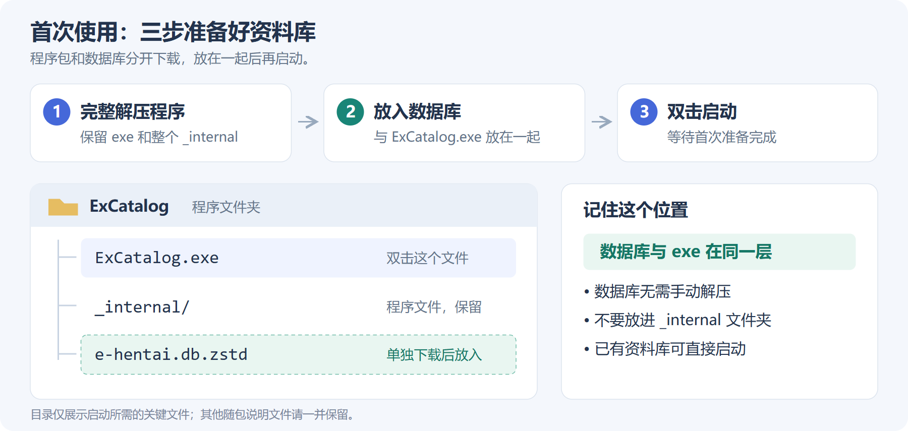
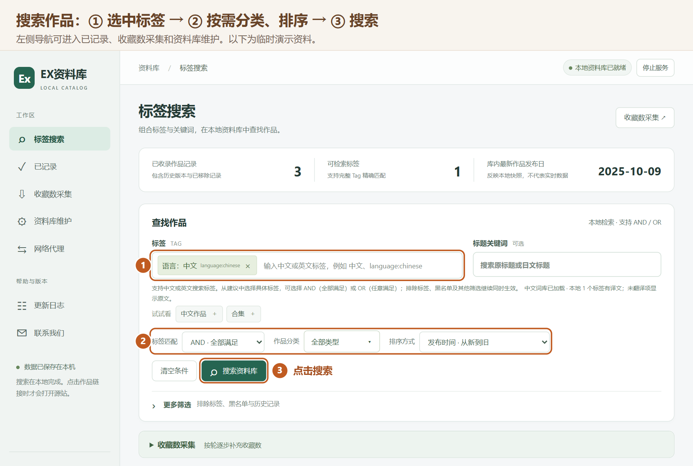

# EX资料库

在 Windows 本地用中文或英文标签查找 E-Hentai / ExHentai 作品，查看收藏数、记录阅读状态。

**[下载客户端](https://github.com/IGreyeyes/exhentai-local-catalog/releases/latest) · [下载作品数据库](https://github.com/URenko/e-hentai-db/releases/tag/nightly) · [反馈问题](https://github.com/IGreyeyes/exhentai-local-catalog/issues)**

适用于 Windows 10 / 11 x64，自带 Python，无需安装 Python 或输入命令。缺少 WebView2 时，按启动提示安装 [微软 WebView2 Runtime](https://developer.microsoft.com/microsoft-edge/webview2/)。

## 三步开始

1. **下载并解压程序**：在客户端发布页的 **Assets（附件）** 中下载 `ExCatalog-Windows-x64.zip`，完整解压到固定文件夹。不要在 ZIP 内运行，也不要只取出 exe；`Source code` 是源码。
2. **放入数据库**：在数据库下载页下载 **`e-hentai.db.zstd`**，无需解压，放到 **`ExCatalog.exe` 同一文件夹**，不要放进 `_internal`。
3. **双击启动**：运行 `ExCatalog.exe`，等待自动解压数据库、建立索引和准备中文词库，完成后进入搜索页。首次准备需要一些时间，请保持窗口打开。

> 程序包不含作品数据库。已有 `data/catalog.sqlite3` 的用户可直接启动，无需重新下载。提示「未找到数据库」时，点击「打开存放目录」，放好文件后点「重新检测」。

## 第一次搜索

1. 在 **标签搜索** 输入 `中文` 或 `language:chinese`，从建议中选中标签。
2. 按需填写标题、选择分类和排序，然后点击 **搜索资料库**。
3. 点击结果中的作品标题，在默认浏览器打开源站页面。需要排除标签时，展开 **更多筛选**。

*图中为临时演示资料。中文词库暂不可用时，可先用 `language:chinese` 等英文标签搜索。*

## 常用操作

| 想做什么 | 到哪里、怎么操作 |
| --- | --- |
| 补充收藏数 | 先搜索，再打开 **收藏数采集**；配置源站访问与采集策略 → **应用本次设置** → 验证访问 → 预估并确认开始。 |
| 采集一段时间后自动休息 | **收藏数采集 → 采集策略** 勾选 **启用定时休息，到时自动继续**，填写连续采集和每次休息的分钟数，再应用设置。 |
| 查看记录、标记看过 | 打开 **已记录**，点击爱心标记「看过」、划线圆圈标记「不看」；再次点击取消。 |
| 备份资料 | **资料库维护 → 备份资料**，选择保存位置，点击 **立即备份**；换电脑时建议勾选「同时备份作品目录」。 |
| 恢复备份 | **资料库维护 → 恢复备份**，选择具体的一份备份文件夹，检查后确认恢复。 |
| 更新作品目录 | **资料库维护 → 作品目录**，点击醒目的 **前往 GitHub 下载目录**，将新版 `e-hentai.db.zstd` 放到提示的位置，检查后点击 **备份旧版并应用更新**。 |
| 导入他人的收藏数与失败记录 | **资料库维护 → 收藏数导入导出**，选择 `.ehfavorites.json` 文件，检查后确认合并；完成后查看 **合并成功** 及各项数量。 |
| 在线同步收藏数 | **资料库维护 → 在线同步**，按需勾选上传或下载并保存；两项首次默认关闭，开启上传前请阅读分享范围。 |
| 配置网络 | 打开 **网络代理**，保存设置后使用页面上的连接测试。 |

收藏数显示「未知」时，可自行采集、导入分享文件或开启公共数据下载。数据库不自带收藏数，采集需要能访问所选源站。平时关闭窗口即可退出，等待当前请求保存完成。

收藏数文件的检查、导出和合并会在操作区显示当前状态与结果。**文件检查成功仍需确认合并**；合并时显示处理中，完成后显示「合并成功」，失败时显示原因。若提示结果待确认，请等待重新连接并核对结果，避免重复操作。

### 定时休息

定时休息默认关闭。开启后可分别设置 **连续采集** 和 **每次休息** 的时间，支持 0.1～1440 分钟的小数。例如设置 60 和 10，会按「采集 60 分钟 → 休息 10 分钟 → 自动继续」循环。点击 **应用本次设置** 后保存选择与时长，再验证、预估并确认开始；采集进度区显示倒计时和休息次数，预计耗时包含预计休息时间。

计时包含请求、请求间隔和重试等待，当前请求结束并保存后才休息。休息期间可以 **暂停本轮** 或 **结束任务**，取消自动继续；登录异常、限流或服务重启后也不会自动继续。分轮模式仍在本轮结束后停下，下一轮由你确认。修改时间前先暂停，应用设置后预估并继续，会重新计算连续采集时间。

### 评分全库采集与失败项

无需先搜索，在 **收藏数采集 → 采集策略** 选择「评分全库采集」，应用设置、验证源站访问，再预估并确认开始。队列按平均评分从高到低排列。

「重新采集之前的失败项（评分全库）」**默认关闭**，应用设置后记住选择。关闭时沿用同一源站、同一作品链接的失败记录；预估单列「沿用失败记录（未请求）」，进度区分别显示本次失败和沿用失败记录。重启、结束后新建计划或升级后继续旧队列，都不会自动重新请求这些失败项。新遇到的不可访问作品仍会增加本次失败数。

需要接着上次进度时，使用 **暂停／继续采集**；**结束任务** 后再开始会重新建立队列。确认作品恢复访问后，可开启重采开关并应用设置，再预估、验证和确认，或点击 **重试失败项** 单独再试。开关只影响符合本次范围及缓存规则的项目；切换源站或作品链接变化时，按新的访问目标处理。普通访问验证会避开已保存的失败项；需要主动再验证时，可使用 **重新验证失败作品**。

## 升级与保留资料

点击客户端的 **检查客户端更新**，按提示下载并安装；仅检查版本不会自动安装。

手动升级时，先在维护页备份并关闭应用。将新版解压到临时文件夹，再替换原目录中的 `ExCatalog.exe`、完整 `_internal` 和说明文件。

**请保留原有 `data`、`logs`、`backups` 和 `e-hentai.db.zstd`。** 个人收藏数、阅读状态和采集进度保存在 `data` 中，无需重新采集或下载数据库。v1.0.0 首次升级、旧版检查更新报错时，使用手动升级。

Linux 服务器运行源码时：先暂停采集、备份资料并停止服务，保留旧版程序；核对版本及 Python 3.14 环境后更新源码，再重启并检查服务。本次没有新增依赖或数据库表结构迁移。保留资料库、采集进度、阅读状态、日志、备份、作品目录压缩包、私有代理及 SSH / systemd 配置；失败时停止新版并恢复旧程序。重启后按实际提示重新填写 Cookie、验证并手动继续，不自动启动真实采集。Windows 加密登录文件继续仅适用于 Windows，Linux 不会改为明文保存凭据。准备客户端包不会自动更新现有服务器。

## 遇到问题

| 情况 | 处理方法 |
| --- | --- |
| 中文标签没有建议 | **资料库维护 → 中文词库**，安装或更新词库。 |
| 换了数据库文件，作品没变化 | 在 **资料库维护 → 作品目录** 检查并应用，放入文件不会自动替换现有资料库。 |
| 封面加载失败 | 点击失败封面旁的 **测试封面连接**，网络恢复后再点 **重试封面**。 |
| 采集验证失败或限流 | 先在浏览器确认同一源站可访问，再核对登录与代理设置；限流时按提示等待后重新验证。 |
| 更新检查或下载失败 | 点击 **重新检查**，或从[发布页](https://github.com/IGreyeyes/exhentai-local-catalog/releases/latest)下载完整包手动升级。 |

更多帮助见客户端 **联系我们**；完整版本历史见 **更新日志**。

---

[v1.2.13 更新说明](RELEASE_NOTES.md) · [源码与构建](DEVELOPMENT.md) · [桌面高级选项](DESKTOP.md) · [同步服务部署](https://github.com/IGreyeyes/exhentai-local-catalog/blob/master/cloudflare/README.md)

数据来源：[URenko/e-hentai-db](https://github.com/URenko/e-hentai-db)；中文标签：[EhTagTranslation/Database](https://github.com/EhTagTranslation/Database)。译文归 EhTagTranslation 全体编辑者所有，采用 [CC BY-NC-SA 3.0 CN](https://creativecommons.org/licenses/by-nc-sa/3.0/cn/) 许可。详见 [第三方说明](THIRD_PARTY_NOTICES.md)。
